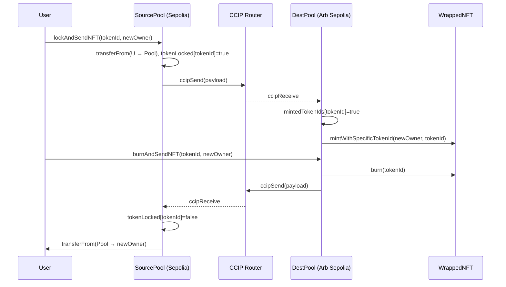

# CCIP NFT Vault

A Foundry-based cross-chain NFT bridge built on Chainlink CCIP. NFTs are locked on the source chain and wrapped on the destination chain, with a full test: unit, integration (local simulator), fork, and invariant testing.

> ⚠️ Testnet project. Not audited. Do not use with real assets.

---
## What it does

Source chain (Ethereum Sepolia) → Destination chain (Arbitrum Sepolia):

1. User approves and calls `lockAndSendNFT(tokenId, newOwner, destChain, destPool, feeToken, gasLimit)`.
2. Source pool locks the NFT and sends a CCIP message.
3. Destination pool receives the message and mints a wrapped NFT with the **same tokenId**.
4. To return: user calls `burnAndSendNFT(...)` on the destination; the wrapped NFT is burned and a CCIP message is sent back.
5. Source pool receives the message, unlocks the original NFT, and transfers it to the new owner.



---
## Why this design

| Decision                                                         | Rationale                                                                                                                                                                  |
| ---------------------------------------------------------------- | -------------------------------------------------------------------------------------------------------------------------------------------------------------------------- |
| **Lock-and-mint** (not burn-and-mint)                            | The original NFT must survive the round trip; the source pool must never be able to re-mint an already-minted original.                                                    |
| **Same tokenId** on both chains                                  | Allows the destination chain to reconcile messages by tokenId and prevents silent token duplication.                                                                       |
| **Business-level idempotency** (`tokenLocked`, `mintedTokenIds`) | Defense in depth against cross-chain replays and misconfigured allowlists.                                                                                                 |
| **Plain ERC721** (no `ERC721Enumerable`)                         | The bridge never batch-mints per message; O(n) enumeration storage was never amortized. See `test/fuzz/MintGasComparison.t.sol` for the gas benchmark that justified this. |
| **`WrappedNFT.burn` is `onlyOwner`**                             | Users cannot burn wrapped NFTs directly, which would permanently lock the original on the source chain.                                                                    |
| **Bilateral allowlist** (chain + sender)                         | Both checks are needed: chain allowlist blocks messages from unrelated chains; sender allowlist blocks same-chain impersonation.                                           |
| **Fee paid by `msg.sender`**                                     | The pool never subsidizes user transactions; prevents draining any LINK that ends up in the contract.                                                                      |

---
## Repository layout

```text 
src/
├── core/
│   ├── CCIPReceiverBase.sol      # Allowlist + send helper (LINK / native gas)
│   ├── NFTPoolLockAndRelease.sol # Source chain
│   ├── NFTPoolBurnAndMint.sol    # Destination chain
│   └── WrappedNFT.sol            # ERC721 with pool-only mint/burn
├── libraries/
│   └── CCIPErrors.sol            # Shared custom errors
├── mocks/
│   ├── MyNFT.sol                 # Source NFT (mock, testnet only)
│   ├── PlainERC721.sol           # Gas benchmark mock
│   ├── PlainERC721Enumerable.sol # Gas benchmark mock
│   └── PlainERC721A.sol          # Gas benchmark mock
test/
├── unit/                         # Pure logic with mock router
├── fuzz/                         # Gas benchmark fuzz
├── fork/                         # Real Sepolia ↔ Arb Sepolia fork
└── invariant/                    # Handler-driven invariants
script/
├── DeployLocal.s.sol
├── DeploySepoliaSource.s.sol
├── DeployArbitrumSepoliaDest.s.sol
└── ConfigureLanes.s.sol
```

---
## Quick start

### Install deps

```bash
forge install
```

### Build and run all non-fork tests

```bash 
forge build
forge test --no-match-path "test/fork/*"
```

### Run fork tests (needs archive RPCs)

```bash
cp .env.example .env && $EDITOR .env   # fill SEPOLIA_RPC_URL, ARBITRUM_SEPOLIA_RPC_URL
source .env
forge test --match-path "test/fork/*"
```

### Deploy locally

```bash
anvil &
forge script script/DeployLocal.s.sol --rpc-url localhost --broadcast
```

### Testnet Deployment

#### Deploy Source Chain (Sepolia)

Requires SEPOLIA_PRIVATE_KEY, SEPOLIA_ROUTER, SEPOLIA_LINK in env. 

```bash
forge script script/DeploySepoliaSource.s.sol --rpc-url sepolia --broadcast --verify
```

#### Deploy Destination Chain (Arbitrum Sepolia)

Requires ARBITRUM_PRIVATE_KEY, ARBITRUM_ROUTER, ARBITRUM_LINK in env.

```bash
forge script script/DeployArbitrumSepoliaDest.s.sol --rpc-url arbitrum_sepolia --broadcast --verify
```

---

## Deployments

⚠️ Testnet only. Not audited. Do not use with real assets.
### Ethereum Sepolia (source chain)

- Chain selector: `16015286601757825753`
- CCIP Router: `0x0BF3dE8c5D3e8A2B34D2BEeB17ABfCeBaf363A59`
- LINK: `0x779877A7B0D9E8603169DdbD7836e478b4624789`

| Contract              | Address                                                                                                                       |
| --------------------- | ----------------------------------------------------------------------------------------------------------------------------- |
| MyNFT                 | [0xa6E147ff59B174aD9305Cba242d4e2a144bd530E](https://sepolia.etherscan.io/address/0xa6E147ff59B174aD9305Cba242d4e2a144bd530E) |
| NFTPoolLockAndRelease | [0xF64b2Ca1a06c43486Ef8E3B8F645D87E4e4369aB](https://sepolia.etherscan.io/address/0xF64b2Ca1a06c43486Ef8E3B8F645D87E4e4369aB) |

### Arbitrum Sepolia (destination chain)

- Chain selector: `3478487238524512106`
- CCIP Router: `0x2a9C5afB0d0e4BAb2BCdaE109EC4b0c4Be15a165`
- LINK: `0xb1D4538B4571d411F07960EF2838Ce337FE1E80E`

| Contract           | Address                                                                                                                      |
| ------------------ | ---------------------------------------------------------------------------------------------------------------------------- |
| WrappedNFT         | [0xBb13b970B4669A2f8c9e96C6b2f818A1e2847Ca1](https://sepolia.arbiscan.io/address/0xBb13b970B4669A2f8c9e96C6b2f818A1e2847Ca1) |
| NFTPoolBurnAndMint | [0xD69a4c21036F113d918A4C7eF60E56C9783763D6](https://sepolia.arbiscan.io/address/0xD69a4c21036F113d918A4C7eF60E56C9783763D6) |

### Verified cross-chain flow

| Direction                              | CCIP Explorer                                                                                                                                                        |
| -------------------------------------- | -------------------------------------------------------------------------------------------------------------------------------------------------------------------- |
| Sepolia → Arb Sepolia (lock → mint)    | [0x15381792cd74a3462a0b83346a80a976dc28044b46ebeaa9db51f62454f7e3a6](https://ccip.chain.link/msg/0x15381792cd74a3462a0b83346a80a976dc28044b46ebeaa9db51f62454f7e3a6) |
| Arb Sepolia → Sepolia (burn → release) | [0x144fae08706ddded6549855987990d6b55182393fb61a15f5c8dfc10cb2bbe26](https://ccip.chain.link/msg/0x144fae08706ddded6549855987990d6b55182393fb61a15f5c8dfc10cb2bbe26) |

---
## Test suite

|Suite|Tests|Purpose|
|---|---|---|
|`test/unit/NFTPoolLockAndRelease.t.sol`|8|Allowlist, fee modes, refund, revert paths|
|`test/unit/NFTPoolBurnAndMint.t.sol`|10|Mint idempotency, burn auth, replay protection|
|`test/unit/CCIPLocalFlow.t.sol`|2|End-to-end via `CCIPLocalSimulator`|
|`test/fuzz/MintGasComparison.t.sol`|2|ERC721 / Enumerable / ERC721A gas benchmark|
|`test/fork/CCIPFork.t.sol`|2|Real Sepolia ↔ Arb Sepolia Router / LINK|
|`test/invariant/*`|2 suites|12800 handler calls per suite, 0 invariants broken|

Total: **26 tests**, all passing.

### Gas snapshot (mint 10 tokens)

|                  | Gas     |
| ---------------- | ------- |
| Plain ERC721     | ~659k   |
| ERC721Enumerable | ~1,538k |
| ERC721A          | ~111k   |

This benchmark is why the bridge uses plain ERC721: the bridge does not batch-mint, so the storage overhead of Enumerable would never be amortized, while ERC721A's storage model would break the `ownerOf` assumption used in the destination pool's checks.

---
## Security considerations

- Custom errors for all revert paths, no `require` strings.
- `tokenLocked` / `mintedTokenIds` updated before external calls (CEI).
- No `nonReentrant` needed: `_ccipReceive` calls only ERC721 (`transferFrom`), and the state is already updated before the call.
- `WrappedNFT.burn` is `onlyOwner` so users cannot skip the bridge.
- `finalityConfig = bytes4(0)` → full source-chain finality (default, safest).

---
## Known limitations

- **Not audited**. Do not use with real assets.
- **No rate limiting**. A production bridge should add per-window caps.
- **No emergency pause**. In production, the owner should have a time-locked pause on the pools.
- **`MyNFT` is a mock**. Real deployments would point the source pool at an existing collection; `WrappedNFT` would then need a deterministic tokenId mapping if the original collection is not ERC721Enumerable.

---
